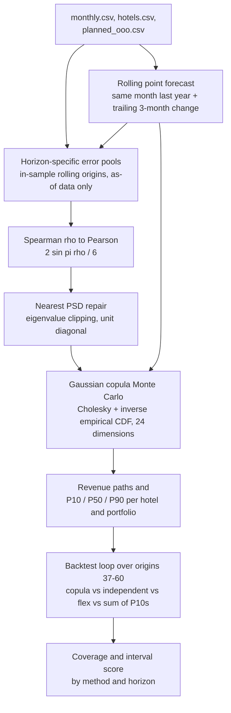

# rangecast

[](https://github.com/SlateGitOrg/rangecast/actions/workflows/ci.yml)


rangecast turns a rolling hotel revenue forecast into a range. It takes the usual FP&A point forecast
(same month last year, adjusted by the trailing 3-month year-over-year change), collects how wrong that
method was at each horizon on as-of data, and samples occupancy and ADR errors for all 12 hotels
together through a Gaussian copula, so hotels in one market move together and rate moves with
occupancy within a hotel. A rolling-origin backtest scores the resulting P10-P90 band against an
independent-sampling band, two +/-5% flex bands (occupancy and ADR flexed together, and each on its
own) and the sum of hotel P10s. All data is synthetic.

## The problem

FP&A at a 12-hotel select-service group produces a rolling 12-month forecast of revenue (rooms x
occupancy x ADR, plus other revenue per occupied room) as one number, and the lender now wants a
downside case. The team's "range" flexes occupancy and ADR by 5% independently, a band nobody has
checked against what happened. Hotels in one city rise and fall together and rate moves with occupancy,
so independent flexing misjudges the risk of the portfolio. A range is only useful if about 80% of
outcomes land inside an 80% band; this project measures that.

## How it works



* **Data.** `rangecast generate` writes `hotels.csv` (id, market, rooms), `monthly.csv` (rooms available
  after out-of-order, occupancy, ADR, other revenue per occupied room), `planned_ooo.csv` and
  `truth.json`. There are 12 hotels in 4 markets and 72 months. Shocks mix a market factor (60% of the
  variance), hotel noise, and a 0.6 occupancy-ADR correlation. The monthly shock has a standard
  deviation of 1.0 occupancy point and 3.5% in ADR (log). Occupancy noise is kept small because the
  point forecast carries about 1.3 times the monthly shock plus shared market noise, and an M2 shift
  that is meant to be recoverable to within 2 points would be buried by a larger one (at 1.5 points the
  M2 check failed). ADR is the more volatile driver and carries most of the revenue noise. Two events are injected: market M2 gains
  6 occupancy points from month 50, and hotel H05 has 30% of its rooms out of order in months 64-67,
  announced in `planned_ooo.csv`.
* **Point forecast.** Occupancy = occupancy a year before the target plus the mean year-over-year change
  of the last 3 months (in points); ADR = ADR a year before times the ratio of the last 3 months to the
  same months a year earlier.
* **Errors.** For each origin `s` and horizon `k`, occupancy error in points and ADR error as
  `log(actual / forecast)`. The pool at origin `t` holds only origins with `s + k <= t`.
* **Copula.** Spearman rho of the 24 error columns per horizon, mapped to Pearson, repaired to the
  nearest positive semidefinite correlation matrix, factorised with Cholesky, and pushed through each
  column's inverse empirical CDF.
* **Revenue.** `rooms available x days x occupancy x ADR + other revenue per occupied room x occupied
  rooms`, per path and hotel, summed to the portfolio. Occupancy is clipped to [0, 1] and clips are counted.

## Quick start

```bash
python -m venv .venv && . .venv/bin/activate
pip install -e ".[dev]"

rangecast generate --seed 7 --out data/     # hotels.csv, monthly.csv, planned_ooo.csv, truth.json
rangecast forecast                          # 12-month percentile tables from the last month
rangecast forecast --origin 60 --paths 5000 # forecast from an earlier origin
rangecast backtest --origins 24             # origins 37-60, horizons 1-12
rangecast correlation                       # estimated error correlations against the truth
rangecast chart                             # fan charts in charts/ (portfolio and H05)
pytest -q
```

`forecast` writes `out/forecast_portfolio.csv`, `forecast_hotels.csv` and `forecast_comparison.csv`;
`backtest` writes `out/backtest_report.md` and `out/backtest_intervals.csv`. `chart` defaults to
origin 60 so the realised months can be drawn over the range.

## Example output

All numbers below come from `rangecast generate --seed 7 --out data/` followed by the commands shown,
with the default 5,000 paths and seed 7.

### `rangecast forecast`

Portfolio revenue percentiles (USD) for the 12 months after the latest origin (2025-12):

| month | P10 | P50 | P90 |
| --- | ---: | ---: | ---: |
| 2026-01 | 6,571,751 | 6,865,457 | 7,165,427 |
| 2026-02 | 5,893,195 | 6,180,703 | 6,474,898 |
| 2026-03 | 7,418,728 | 7,763,243 | 8,121,436 |
| 2026-04 | 6,866,611 | 7,178,638 | 7,512,289 |
| 2026-05 | 7,625,503 | 7,980,804 | 8,335,965 |
| 2026-06 | 7,243,484 | 7,593,888 | 7,971,819 |
| 2026-07 | 7,604,480 | 8,003,132 | 8,412,999 |
| 2026-08 | 7,281,159 | 7,649,921 | 8,026,055 |
| 2026-09 | 7,058,672 | 7,422,181 | 7,791,726 |
| 2026-10 | 6,925,748 | 7,339,284 | 7,765,336 |
| 2026-11 | 6,763,013 | 7,180,118 | 7,616,372 |
| 2026-12 | 6,138,639 | 6,531,288 | 6,924,545 |

Occupancy draws clipped to [0, 1]: 0 of 720,000

### `rangecast backtest`

Origins 37-60 (24), horizons 1-12. Coverage of the P10-P90 band (target 0.80) and mean interval score,
in $000, for the portfolio:

| horizons | copula coverage | independent coverage | flex both coverage | flex each coverage | copula score ($000) | independent score ($000) | flex both score ($000) | flex each score ($000) |
| --- | ---: | ---: | ---: | ---: | ---: | ---: | ---: | ---: |
| 1-3 | 0.75 | 0.49 | 1.00 | 0.81 | 1,004 | 1,220 | 1,446 | 947 |
| 4-6 | 0.71 | 0.40 | 1.00 | 0.81 | 958 | 1,318 | 1,461 | 886 |
| 7-9 | 0.86 | 0.54 | 1.00 | 0.89 | 863 | 1,065 | 1,472 | 819 |
| 10-12 | 0.72 | 0.42 | 0.97 | 0.69 | 1,344 | 1,785 | 1,510 | 1,234 |
| all | 0.76 | 0.46 | 0.99 | 0.80 | 1,042 | 1,347 | 1,472 | 972 |

Over all horizons the copula band covers 0.76 of portfolio outcomes and the independent band 0.46.
The two flex bands need careful reading. "Flex both" lowers (raises) occupancy and ADR by 5% together
for every hotel, a shift of about 10% in revenue; its 0.99 coverage is a consequence of that
definition, not a finding about hotel risk. "Flex each" flexes occupancy and ADR one at a time and
takes the wider case (about 5% in revenue), which is closer to how the team's "independent" flex is
described. It covers 0.80 at the portfolio and has the lowest portfolio score here (972 against 1,042
for the copula), so a fixed 5% band happens to fit this group's portfolio. It does not fit a single
hotel (coverage 0.47 below), and it does not adapt to horizon (0.69 at horizons 10-12), whereas the
copula is calibrated at both levels (0.76 portfolio, 0.79 hotels). Per hotel (coverage and interval
score as a percentage of the hotel's revenue):

| hotel | copula coverage | independent coverage | flex both coverage | flex each coverage | copula score (% of revenue) | independent score (% of revenue) | flex both score (% of revenue) | flex each score (% of revenue) |
| --- | ---: | ---: | ---: | ---: | ---: | ---: | ---: | ---: |
| H01 | 0.76 | 0.70 | 0.86 | 0.50 | 26.7 | 27.2 | 23.6 | 28.1 |
| H02 | 0.77 | 0.69 | 0.76 | 0.45 | 32.9 | 33.7 | 31.0 | 40.1 |
| H03 | 0.88 | 0.80 | 0.92 | 0.63 | 23.4 | 22.6 | 22.1 | 23.3 |
| H04 | 0.71 | 0.60 | 0.71 | 0.39 | 35.7 | 38.8 | 33.5 | 45.1 |
| H05 | 0.82 | 0.74 | 0.80 | 0.47 | 27.2 | 26.6 | 24.9 | 33.0 |
| H06 | 0.76 | 0.58 | 0.77 | 0.42 | 31.7 | 34.8 | 28.8 | 39.3 |
| H07 | 0.76 | 0.62 | 0.69 | 0.41 | 32.9 | 34.8 | 31.5 | 43.4 |
| H08 | 0.82 | 0.77 | 0.77 | 0.53 | 33.2 | 32.7 | 31.8 | 38.2 |
| H09 | 0.91 | 0.81 | 0.91 | 0.56 | 24.5 | 22.9 | 22.2 | 24.5 |
| H10 | 0.78 | 0.67 | 0.76 | 0.42 | 32.6 | 33.6 | 29.4 | 39.8 |
| H11 | 0.70 | 0.58 | 0.78 | 0.36 | 28.5 | 31.1 | 27.6 | 38.1 |
| H12 | 0.81 | 0.74 | 0.87 | 0.55 | 30.5 | 30.0 | 26.2 | 30.1 |
| all hotels | 0.79 | 0.69 | 0.80 | 0.47 | 30.0 | 30.7 | 27.7 | 35.2 |

At hotel level the copula, independent and flex-both methods are close: within one hotel, independent
sampling loses only the occupancy-ADR dependence. The gap opens at the portfolio, where market-level
dependence adds up across hotels. Flex-each is too narrow for a hotel (score 35.2 against 30.0).

The sum of hotel P10s against the portfolio P10 at the same origin and horizon:

| horizons | sum of hotel P10s ($000) | portfolio P10 ($000) | gap (% of P10) | actual below portfolio P10 | actual below sum of hotel P10s |
| --- | ---: | ---: | ---: | ---: | ---: |
| 1-3 | 6,521 | 6,934 | 6.0 | 0.15 | 0.00 |
| 4-6 | 6,599 | 6,989 | 5.6 | 0.19 | 0.00 |
| 7-9 | 6,618 | 7,021 | 5.7 | 0.10 | 0.00 |
| 10-12 | 6,622 | 7,072 | 6.4 | 0.22 | 0.01 |
| all | 6,590 | 7,004 | 5.9 | 0.17 | 0.00 |

Adding up hotel P10s is below the portfolio P10 in every one of the 288 cells and outcomes essentially
never fall under it, so it overstates the downside; the portfolio P10 is breached 17% of the time
(target 10%).

### `rangecast correlation`

Error correlations at origin 72, averaged over horizons 1-12

| correlation | estimated | truth | difference |
| --- | ---: | ---: | ---: |
| within hotel: occupancy vs ADR (median hotel) | 0.63 | 0.60 | +0.03 |
| within market: occupancy vs occupancy | 0.59 | 0.60 | -0.01 |
| within market: ADR vs ADR | 0.55 | 0.60 | -0.05 |
| within market: occupancy vs ADR of another hotel | 0.35 | 0.36 | -0.01 |
| across markets: occupancy vs occupancy | 0.04 | 0.00 | +0.04 |
| across markets: ADR vs ADR | 0.02 | 0.00 | +0.02 |

Within-market occupancy error correlation by market:
M1 0.36, M2 0.84, M3 0.61, M4 0.56

The M2 within-market figure is inflated by the injected occupancy shift, which every M2 hotel's errors
share.

## Design decisions

1. **Per-horizon error pools from as-of rolling origins.** The error distribution changes with the
   horizon because the last-year month used as the base, and its overlap with the trailing months used for
   the adjustment, changes, so each horizon has its own pool. The cost is
   small samples: at origin 37 the horizon-12 pool has 11 errors for 24 dimensions, so its Spearman matrix
   has rank at most 10 and the PSD repair does real work. Quantiles use Weibull plotting positions
   (`i / (n + 1)`) so small pools are not narrowed by interpolation, and the band is still a little
   narrow (0.76 against 0.80).
2. **Spearman rank correlation mapped to Pearson instead of a plain Pearson of the errors.** Rank
   correlation is not driven by the few large errors that a level shift such as M2 creates. The mapping
   `2 sin(pi rho / 6)` is exact for Gaussian dependence and approximate otherwise. A Gaussian copula has
   no tail dependence, so joint extremes across markets are not modelled beyond what the errors show.
3. **Horizons are sampled independently.** Each month's band is a marginal band, which is what the
   backtest scores. Errors at different horizons share the same trailing adjustment, so they are in
   fact correlated, and the spread of a 12-month total would be understated; the tool therefore reports
   no 12-month total. It also makes coverage lumpy: errors move together across the 12 horizons of one
   origin, so 288 cells carry far fewer than 288 independent outcomes. Across seeds 1-10 of the
   generator (2,000 paths) the copula portfolio coverage ranged 0.67-0.87 (mean 0.755), the independent
   band 0.41-0.67 and flex-each 0.78-0.92, so the 0.76 for seed 7 is one draw, not a guarantee.
4. **The point method is kept as specified, including its weakness.** When a level shift is in both the
   trailing change and the last-year month, it is counted twice (M2 targets from month 62 forecast from
   origins 52-60). Those errors enter the pools only once they are observed, so the band does not
   anticipate them; the project measures the common method rather than repairing it.
5. **Other revenue follows ADR, and the samplers share random numbers.** Other revenue per occupied
   room is the trailing 12-month ratio to ADR times the sampled ADR, so it rises and falls with rate;
   that keeps the revenue identity exact on every path with no extra random draw. The copula and
   independent samplers use the same underlying normals and the same marginals, so the difference
   between their bands is only the dependence.
6. **Two flex bands, because the comparator is ambiguous.** "Flex occupancy and ADR by 5%
   independently" can mean each driver on its own (about 5% of revenue) or both at once (about 10%).
   Both are reported so the result does not hinge on one reading. Neither is a probabilistic band, and
   neither changes with the hotel, the horizon or the dependence between hotels.

## Testing

```bash
pytest -q
```

73 tests, all offline, run with warnings as errors. They cover the generator's documented properties
and injected events; a hand-built point-forecast fixture; error pools and the as-of rule; the PSD repair
against two hand-computed matrices; the copula sampler (pairwise Pearson within 0.05 on 20,000 draws,
KS < 0.02 per marginal); the exact revenue identity on every path and the clip count; the renovation
(P50 rooms revenue is 0.70 of the run without the schedule); the M2 point forecast from origin 54;
no look-ahead (identical forecast from truncated or corrupted future data); seed reproducibility; the
backtest acceptance bands (copula coverage in [0.70, 0.90], independent coverage <= 0.65, copula score
below independent, sum of hotel P10s below portfolio P10 in every cell); the estimated correlations
against the truth; the CLI end to end.

## Project layout

```
src/rangecast/
  months.py         month indexing and calendar days
  generate.py       seeded synthetic hotel group and CSV writer
  data.py           Dataset (aligned arrays), loader, truncation as-of an origin
  pointforecast.py  same month last year + trailing 3-month change
  errors.py         horizon-specific rolling-origin error pools
  copula.py         Spearman to Pearson, PSD repair, Cholesky, empirical marginals
  simulate.py       revenue paths, flex band, per-cell seeding
  forecast.py       percentile tables for one origin
  backtest.py       rolling-origin backtest, coverage, interval score
  correlation.py    estimated error correlations against the truth
  report.py         Markdown tables and the backtest report
  charts.py         fan charts (Agg backend)
  cli.py            typer commands
tests/              one test module per source module, plus CLI tests
.github/workflows/ci.yml
```

## License

MIT. See `LICENSE`.
